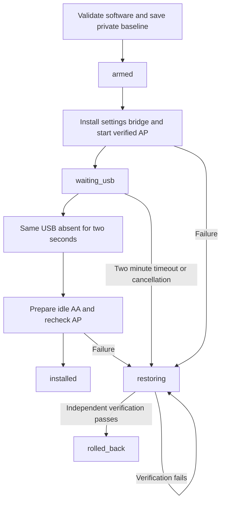

# Wi-Fi startup and AA access point activation

This guide describes how the package starts and verifies the existing OEM Wi-Fi access point for wireless Android Auto. It is an implementation guide for `DL3.KOR.S5W_M.V039.001.260902`, not a generic Android hotspot recipe. NEMESIS supplies privileged execution; wireless projection features must already be enabled, for example through the Leafia basic functionality used in the original vehicle test.

The connection primitives succeeded on the reference K5 in **0.4.4**. The current **0.5.0** package reuses those primitives with a simpler installation lifecycle; that new lifecycle has host verification and still needs a vehicle test. CarPlay and reliable automatic AA reconnection after a full infotainment shutdown are separate unresolved areas.

## Implementation map

All links below are package-relative and refer to the current source.

| Responsibility | Source |
| --- | --- |
| Validate the USB payload and wait for AP preparation | [NEMESIS.sh.in](../usb/NEMESIS.sh.in) |
| Check firmware, software hashes and prior workers; create the backup | [pre.sh](../package/scripts/pre.sh), [profile.json](../profile.json) |
| Register the setup worker and restore action | [package descriptor](../package/NEMESIS.data), [setup.sh](../package/svc/setup.sh) |
| OEM Wi-Fi calls, Parcelable backup, service restart and restore adapter | [Main.java](../src/com/saintkite/k5aa/Main.java) |
| Set the actual AP name and key to the AA values | [ApCredentials.java](../src/com/saintkite/k5aa/ApCredentials.java) |
| Parse hostapd and compare passphrases or derived PSKs | [ApComparison.java](../src/com/saintkite/k5aa/ApComparison.java) |
| Preserve exact global settings through the OEM provider | [ExternalSettings.java](../src/com/saintkite/k5aa/ExternalSettings.java) |
| Classify AA state and identify the exact persistent process | [GpmAccess.java](../src/com/saintkite/k5aa/GpmAccess.java), [GpmState.java](../src/com/saintkite/k5aa/GpmState.java), [GpmProcess.java](../src/com/saintkite/k5aa/GpmProcess.java) |
| Wait for removal of the installation USB | [UsbSessionRecovery.java](../src/com/saintkite/k5aa/UsbSessionRecovery.java) |
| Apply or restore the installation transaction | [Installation.java](../src/com/saintkite/k5aa/Installation.java), [restore.sh](../package/bin/restore.sh) |

## Wi-Fi hardware and feature flags

Keep these three conditions separate:

1. Feature flags allow the projection software to offer wireless functionality.
2. The Wi-Fi driver, radio firmware and interface are operational.
3. An AP is running with the settings expected by the projection service.

An engineering screen showing a Wi-Fi version or a feature XML alone does not establish the second or third condition. An all-zero MAC display also does not by itself prove missing hardware. On the reference unit, subsequent runtime evidence showed Broadcom DHD initialization, radio firmware loading, successful NVRAM transfer and a registered `wlan0` interface; later phone association and actual AA operation established usable radio/AP functionality.

The captured firmware uses paths including `/data/misc/wifi/fw_bcmdhd.bin`, `/data/misc/wifi/bcmdhd.cal` and `/system/wifi/89359.clm_blob`. These are explanatory observations for the pinned image, not files that this package replaces or distributes. Do not publish calibration/NVRAM contents: they can contain device-specific data.

A one-off development probe used `svc wifi enable` to observe driver initialization and then restored the preceding Wi-Fi setting. **That probe is not part of normal installation.** The normal package starts the OEM AP through its Connectivity API. It does not first enable the Wi-Fi client, join another network, issue `insmod`, reload firmware or start a second DHCP server.

`WifiManager.isWifiEnabled()` describes client Wi-Fi and is saved for restoration. A false client value is compatible with a working AP. Conversely, writing `wifi_on=1` or `wifi_ap_on=1` is not an AP readiness check.

## Two AP credential field pairs

The pinned OEM `WifiConfiguration` contains both ordinary hotspot fields and Connectivity fields:

| Reader | Name | Credential |
| --- | --- | --- |
| Actual AP startup path observed on this image | `SSID` | `preSharedKey` |
| Stock GPM `WirelessExplorer.getWiFiInfo()` path | `ConnectivitySSID` | `ConnectivityPSK` |

Private analysis of the pinned OEM software identified those readers. On the failed reference trial, the running AP name matched the ordinary field and differed from the Connectivity field. This is a configuration mismatch even when Bluetooth replies and the AA listening socket appear normal.

The fix loads an independent copy of the original Parcelable and changes only:

```java
copy.SSID = copy.ConnectivitySSID;
copy.preSharedKey = copy.ConnectivityPSK;
```

This is conceptual code for the operation inside `ApCredentials.align()`. It must run inside the backup/apply/verify/restore transaction, not as a stand-alone setter. The private original and the two Connectivity fields remain unchanged. The installed bridge is only a settings-route adapter; it does not supply Wi-Fi credentials or implement AA video transport.

The comparison is against **current fields read by the pinned GPM source**. It is not a capture of Bluetooth wire credentials or GPM's internal cache. Refreshing an idle AA process after USB removal addresses a retained start state and gives the new process a chance to read current configuration; it does not prove every internal cache was observed.

## Backup and preconditions

Before applying changes, the package requires root, the exact firmware string and matching hashes of `framework.odex`, `services.odex`, `PhoneProjection.odex` and `HKMC_GPM.odex`. Those hashes identify shared software builds, not individual vehicles. Old trial package directories are rejected. An existing application in `com.daudio.app.deviceconnections` is not overwritten.

The Java preflight also requires the stock WPP settings activity, the expected Wi-Fi methods, a stable AP state, valid Connectivity credentials, an unstopped AA package and a stable idle GPM state. Unknown or changing states abort rather than being treated as idle.

The private state directory is `/data/nemesis/k5-wireless-aa`. It contains:

| Private item | Purpose |
| --- | --- |
| `original-ap.parcel` | Complete OEM AP configuration, including fields a generic Android serializer might miss |
| `original.properties` | AP checksum, original AP/client states, global settings or their absence, temporary boot property, bridge hash, boot identity and installation-media information |
| `runtime.jar`, `restore.sh` | Recovery tools retained outside the installed package tree |
| `phase`, `decision` | Transaction progress and cancellation request |

Original AP bytes are synced to disk and checked with SHA256 when loaded. Files are restricted to the owner and the state directory to owner access. The backup contains real credentials and must stay private. A previously restored installation can retry only after independent restoration verification; the original AP baseline is retained. An unfinished or installed state is not overwritten by taking a new baseline.

Global settings use `getContentProviderExternal("settings", 0, token)`, `GET_global`/`PUT_global`, a null calling package and `_user=0`. The provider is released in `finally`. A setting that was absent is represented separately and deleted on restore; it is not replaced with an assumed default. This route avoids the pinned ROM's ordinary-provider caller-registration problem for a root `app_process` command.

## AP activation sequence

The setup worker uses the existing OEM Wi-Fi service. It does not edit `hostapd.conf` directly.

Its root `app_process` environment includes the OEM vendor/system library paths. The Java entry prepares a main Looper if one is absent before creating the system context. Every completed command explicitly calls `System.exit`: Binder/framework threads can survive a normal `main()` return on this KitKat image. A command hang or `Killed` message therefore needs execution-context evidence; it is not sufficient evidence of a missing Wi-Fi module. The separate Manager `GET_TASKS`/activity-finish compatibility fix is not part of the radio startup sequence.

1. Create the system context using `ActivityThread.systemMain()` and obtain `WifiManager`.
2. Load the private original Parcelable and verify its checksum.
3. Construct the independent working configuration and validate its Connectivity fields.
4. Assign ordinary `SSID/preSharedKey` from the Connectivity values on that working copy.
5. Call `setWifiApEnabledForConnectivity(copy, true)` through the captured OEM method signature. An explicit false return is a failure.
6. Poll for up to **35 seconds**, sleeping **500 ms** between attempts. State **14** fails immediately. State **13** plus AP mode **2** permits the additional configuration checks below.
7. Require actual configuration/credential verification. A stale or partially written hostapd configuration is not accepted as readiness.
8. Mark `waiting_usb` only after AP checks pass. The installer can then display Operation success and request USB removal.

| Runtime value | Interpretation in this implementation |
| --- | --- |
| AP state `11` | Disabled; also one accepted stable preflight state |
| AP state `13` | Enabled; configuration checks are still required |
| AP state `14` | AP failure |
| AP mode `2` | Required Connectivity mode on this pinned image |
| Any nonstable preflight AP state | Abort without beginning a new apply transaction |

The reference AP operated on 5 GHz channel 149. The code does **not** force that channel or rewrite band, country or calibration settings. Reusing that observed channel as a universal fix would change the procedure being described.

## AP readiness and credential verification

The current implementation requires all of the following:

- The Connectivity SSID is 1 to 32 UTF-8 bytes with no control characters.
- `ConnectivityPSK` is 8 to 63 printable ASCII characters; the captured `getAuthType()` value is `4`.
- The current ordinary AP fields equal the Connectivity fields.
- The actual hostapd SSID bytes equal the expected Connectivity SSID. Both literal `ssid` and hex-encoded `ssid2` forms are handled without trimming meaningful name bytes.
- The hostapd credential matches the expected credential, `interface=wlan0`, `wpa=2`, and `rsn_pairwise` contains `CCMP`.
- If hostapd exposes `wpa_key_mgmt`, its value is `WPA-PSK`.

If hostapd exposes `wpa_passphrase`, compare it in RAM. If it exposes a 64-hex-digit `wpa_psk`, derive the expected WPA key with **PBKDF2-HMAC-SHA1**, SSID bytes as salt, **4096 iterations** and **32 output bytes**, then compare. A derived hostapd PSK is a different representation of the same credential; it is not a reason to overwrite the password.

The parser returns an unknown result for missing or ambiguous credentials, including simultaneous passphrase and PSK fields. Readiness requires a positive match; unknown is not success. Although the comparison helper understands a 64-hex-digit expected key, the normal input validator currently accepts only the printable 8-to-63-character Connectivity passphrase form.

Comparison and a bounded derivation cache stay in RAM. Neither a password, derived PSK nor credential fingerprint is exported. The complete original remains in the private restoration backup. The implementation does not claim guaranteed erasure of Java strings from memory.

## USB removal and AA initialization

In the pinned stock path, a USB storage insertion can leave a wired AA start mode. The connection manager can reject a subsequent wireless initialization before constructing its wireless session. An enabled AP therefore does not resolve a stale AA start state by itself.

`getGPMConnectedMode()` alone is insufficient: on this image it can report a retained start mode when no session is active. `GpmAccess` samples both that mode and `getGpmStatus()` twice. A change between samples aborts the reset. `GpmState` treats status **0** as idle, protects nonzero statuses and rejects unknown ranges or inconsistent combinations.

The setup worker watches the marker saved from the **same installation USB**, not any arbitrary removable drive. The random package media marker is not a vehicle or physical USB serial. It requires **2 seconds of continuous absence** before preparing AA; a return of that marker resets the timer. Missing saved identity or an unreadable marker is handled conservatively.

| Stable state after USB absence | Action |
| --- | --- |
| Idle status `0`, including a retained mode `1` or `2` | Restart the idle GPM service |
| Protected wireless mode `2` | Do not restart the active/starting wireless session; preparation may complete |
| Protected wired mode `1`, unknown or changing state | Do not reset that session; preparation fails and the installation takes its restoration path |

For the eligible idle restart:

1. Inspect the current `gpm` Binder through `com.hkmc.gpm.IGpmInterfaces`.
2. Verify idle state again immediately before the restart sequence.
3. Record that GPM was touched, then force-stop only `com.google.android.projection.sink`.
4. If its persistent process survives, signal only the previously identified PID whose exact command, all four UIDs (`1000`) and process start time still match. No kill-by-name or kill-all-system-UID operation is used.
5. Start `GalReceiverService` explicitly with `startMode=0`.
6. Require a fresh live Binder, a cleared stopped flag and a readable known service state within **20 seconds**.
7. Verify AP readiness again before marking installation complete.

This starts the AA service in a neutral state; it does not simulate selecting a phone or certify that a phone connected. The user-facing **15-second wait** after USB removal allows this asynchronous work to run. It is not a guarantee that the OEM service will complete on every attempt.

## Installation lifecycle



The two-minute USB-removal timer starts after AP readiness. It is distinct from the wrapper's 120-second wait for setup readiness. The worker polls USB preparation every 500 ms. An interrupted pending transaction or a changed boot takes the restore path instead of blindly reapplying.

In **0.4.4**, the eight-minute test window and an explicit keep decision confirmed real AA success. In **0.5.0**, there is no keep UI or reinsertion: `installed` means AP validation and AA preparation completed. It is not a new measurement of association, DHCP or an AA screen. The background setup worker exits when installation or rollback finishes. Its registered entry returns without radio changes when invoked again in a completed state; it is not a boot-time AP initializer or reconnect watchdog.

The temporary `sys.boot_completed` change used during bridge APK installation is restored before AP startup, including on a failure path. It is an OEM package-install compatibility step, not a Wi-Fi activation switch or a broadcast of a new boot event.

## Verified restoration

Disconnect AA before an explicit restore. Use the package's Manager Launch action or the private tool:

```sh
sh /data/nemesis/k5-wireless-aa/restore.sh
```

The restore script stops this package's setup worker. The Java restore path refuses an active/starting or unknown AA state for an explicit restore. It validates the private AP backup before AP mutation, restores the saved temporary boot property, disables the Connectivity AP, restores the original Parcelable, restores the original AP enable state/mode and Wi-Fi client state, then restores exact global values or their absence.

If the AA package was touched, it is returned to a runnable state. The bridge is removed only if its installed APK hash matches the package-owned backup record. An unknown replacement in that namespace is not uninstalled.

Independent verification checks the current AP Parcelable bytes, AP enable state and enabled-mode value, client state, saved globals, boot property and bridge absence. If GPM was touched, its stopped flag and live Binder/state are checked too. Only successful verification permits `rolled_back` and `RESTORE_VERIFIED`. Failure leaves `restoring`; the worker retries without applying again. For an explicit restore failure, the tool returns failure and preserves the baseline for another restore attempt.

On the targeted NEMESIS 1.15 source, uninstall ignores a failing pre-uninstall hook. Therefore **restore and verify before uninstalling**; a successful uninstall message is not proof of restoration. The private baseline and recovery tools are retained outside the package tree. This restores changes managed by this package, not phone pairing records, the WPP device database, firmware/calibration or every internal AA session state.

## Connection troubleshooting

Check the first incomplete layer instead of treating every failure as a Wi-Fi driver problem:

| Observation | What it establishes | Next distinction |
| --- | --- | --- |
| Wi-Fi version or feature flag exists | Software metadata is present | Actual driver/interface and AP runtime |
| `wlan0` exists | An interface was registered | AP enabled state, mode and current configuration |
| AP name is visible | The phone can discover an AP | Correct AP/AA name and credential match, then association |
| AP verification passed | Current AP matches the package's expected settings | Phone association/authentication; not yet an AA connection |
| Association exists but no lease is observed | Some link-layer progress | DHCP evidence and whether the collector read the real lease path |
| AA TCP port `40515` is `LISTEN` | The AA transport is waiting | A peer connection; it is not AA success |
| AA TCP is `ESTABLISHED` with wireless GPM status `6` and a real AA screen | Reference AA session success | Reconnect and normal-use behavior separately |
| Bluetooth auto-connects, AA does not, but selecting the phone works | A manual AA connection path remains usable | Phone auto-start policy, WPP device state and automatic-start event ordering |

The reference 0.4.4 implementation reached association, DHCP, AA TCP establishment and the actual AA screen. After a reset-button reboot, a phone Bluetooth toggle restored the first failed attempt. After a later ignition-off interval, Bluetooth connected automatically while AA required manual device selection. These are different observations; neither establishes a permanent auto-reconnect fix or proves the AP was continuously ready throughout boot.

For the remaining automatic-start issue, compare the failed automatic attempt with a successful manual one. The analyzed WPP path has `auto_connection`, `last_connection`, `on_off` and `init_popup` device state, and a Bluetooth `START_SPP_CONNECT_FOR_CONNECTIVITY` receive path. Those are inspection targets, not a prescription to set every database field to `1` or replay broadcasts. Their current values and the presence/order of that event have not yet been collected for the reported failure.

For 0.5.0, a non-radio-changing status query is available as root:

```sh
CLASSPATH=/data/nemesis/k5-wireless-aa/runtime.jar \
  /system/bin/app_process /system/bin com.saintkite.k5aa.Main \
  status /data/nemesis/k5-wireless-aa
```

It prints phase, AP state/mode, client enable state, `wifi_ap_on` and bridge presence. It initializes the context and can append internal events; it does not start/stop the radio or change AP credentials. These paths are for 0.5.0, not the older trial directory. Detailed authentication/network collection is [a separate opt-in diagnostic build](../diagnostics/README.md). Full captures can contain MACs, addresses or phone-derived names and must remain private until sanitized. Do not share the private Parcelable or print the hostapd passphrase/PSK.

## CarPlay boundaries

This package implements AA-specific AP field alignment, GPM initialization and a WPP settings route. It does not implement a CarPlay Bluetooth/iAP2 bootstrap, patch `libCarPlayCore`, or add CarPlay AAC/Opus conversion and audio handling. The [Leafia implementation description](https://github.com/VysseCodes/HMG-Leafia-Plus/blob/08f4436cf12a9edfdd575748c693c7240c7bdc4d/README.md#how-it-works) treats wireless feature activation, CarPlay Wi-Fi sessions, audio and the Bluetooth bridge as separate components; some parts may already be native on particular firmware. Their presence is not a validation of this K5's complete CarPlay path.

| Scope | Current reference status |
| --- | --- |
| Wireless AA with 0.4.4 | Actual connection confirmed; automatic reconnection remains unresolved |
| New 0.5.0 install lifecycle | Host-verified; no vehicle execution yet |
| Wireless CarPlay | Connection failure reported; no successful session validated |
| Wired CarPlay | Failure suspected by the owner; confirmation and USB/service logs are still needed |

If wired CarPlay also fails, investigate USB/iPhone recognition and the common CarPlay service/library path independently of AP startup. If wired works and wireless fails, separate Bluetooth/iAP2 bootstrap, Wi-Fi negotiation and wireless audio/session handling. Neither branch has been diagnosed here. Do not assume the AA Connectivity fields are the correct CarPlay settings, apply another vehicle's recipes, or attribute a regression to AP alignment without a known working baseline and before/after logs.

## Source and validation boundaries

The normal runtime excludes the detailed collectors, trial screens and test classes. Development tests cover AP/credential rejection, exact restoration, corrupt-backup refusal, pending-install refusal, retries that retain the baseline, AA-state/process protection and packaged hook failures. The 0.5.0 contribution recorded 90 host checks including the separate Manager fault checks; those checks do not substitute for a vehicle run of the new lifecycle.

Software field mappings and OEM method behavior were checked privately against the pinned image. Original APK/ODEX files, radio images, calibration, captured logs, actual names/addresses and credentials are not distributed in this guide. Source code links explain the implemented procedure; the historical vehicle-successful trial remains in [commit f8af07b](https://github.com/SaintkiteLee/hmg_nemesis/tree/f8af07ba0456cfcaae671391d18162d587ee9b51/Sources/examples/k5-wireless-aa).
